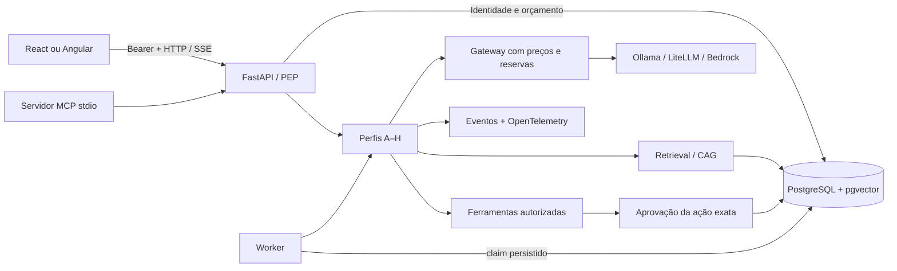

# Arquitetura Atlas

A unidade de segurança é o tenant obtido do token autenticado. React e Angular usam a mesma API FastAPI; o manual é estático e não hospeda serviços. A identidade determina acesso a documentos, execuções, memória, tickets e aprovações. Nenhum ID fornecido pelo navegador substitui essa identidade.

## Componentes e motivos

| Componente | Função observável | Custo/alternativa |
|---|---|---|
| FastAPI/Pydantic | HTTP, validação e OpenAPI | Contratos inválidos retornam 422 antes da operação |
| SQLAlchemy/PostgreSQL | Transações, reservas, fila, tickets, histórico | SQLite é caminho portátil de CI, não substituto de carga distribuída |
| pgvector | Coluna vetorial e distância no banco | Hash local testa mecânica; all-minilm/Ollama fornece embedding aprendido |
| LangChain Core | Composição explícita com RunnableLambda | Não oculta controle de acesso |
| LangGraph | Grafo tipado do perfil F | Estado e retomada têm escopo descrito em backend-evidence |
| Gateway | Um ponto para inferência e contabilização | LiteLLM é adaptador de proxy opcional; orçamento do projeto fica no banco |
| MCP Python SDK | Servidor de ferramentas stdio | Compartilha fronteira de autorização, não concede poderes por protocolo |
| OpenTelemetry | Spans sem texto sensível | Langfuse pode receber OTLP; requer endpoint/chaves para validação real |
| Redis | Não é necessário no caminho inicial | Locks e fila são PostgreSQL; adicionar Redis só para demanda demonstrada |

## Perfis comparáveis

A baseline extrai trechos; B pede JSON validado ao modelo sem retrieval; C recupera evidências; D pré-carrega corpus em contexto com cache tenant/versão/TTL; E adiciona seleção de ferramentas; F explicita estágios como grafo; G separa responsabilidades de especialistas; H desloca execução para worker. O perfil mais complexo não é ativado automaticamente. O comando `/ticket título` expressa intenção de mutação autenticada; documentos nunca conseguem originá-lo.

A variante D é **Cache-Augmented Generation por contexto pré-carregado armazenado na aplicação**. Não pressupõe KV cache, desconto de prefixo ou cache semântico do provedor. O cache aceita até 24 chunks e recusa corpus maior. Um corpus que excede o orçamento de contexto sofre seleção; isso é visível nos eventos e pode reduzir cobertura. Cache inclui versão e tenant e deve ser invalidado em exclusões/reindexação.

## Evolução e limites

O desenho inicial é educacional e executável. Não representa certificação de segurança nem SLA. Evoluções obrigatórias para ambiente público incluem OIDC corporativo, provisionamento de identidades, governança de retenção, backup/restore testado, migrações formais e análise de carga. A infraestrutura AWS mantém ALB privado justamente para evitar expor credenciais de demonstração à internet. Os requisitos com implementação parcial ou condicionada estão na matriz e no relatório final.
